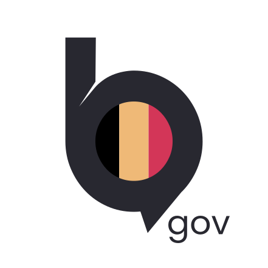

    

Beam web-app: https://web.beam.belgium.be/

Beam website: https://beam.belgium.be/

# Beam web

For now, beam-web is based on [element-hq/element-web v1.12.13](https://github.com/element-hq/element-web/releases/tag/v1.12.13).

Copyright 2026 Belgian Secure Communications (BSC) (regarding possible future modifications for BEAM)

Copyright "element-web" (c) 2014-2017 OpenMarket Ltd Copyright (c) 2017 Vector Creations Ltd Copyright (c) 2017-2025 New Vector Ltd

"element-web" is multi-licensed by New Vector Ltd. (Element). It can be used either (1) for free under the terms of the GNU Affero General Public License (as published by the Free Software Foundation, either version 3 of the License, or (at your option) any later version); OR (2) for free under the terms of the GNU General Public License (as published by the Free Software Foundation, either version 3 of the License, or (at your option) any later version); OR (3) under the terms of a paid-for Element Commercial License agreement between you and Element (the terms of which may vary depending on what you and Element have agreed to). It is used under the terms of the GNU Affero General Public License v3, here. 

The software including BSC modifications is made available under the GNU Affero General Public License v3. Unless required by applicable law or agreed to in writing, software is distributed on an "AS IS" BASIS, WITHOUT WARRANTIES OR CONDITIONS OF ANY KIND, either express or implied. See the Licenses for the specific language governing permissions and limitations under the Licenses.
